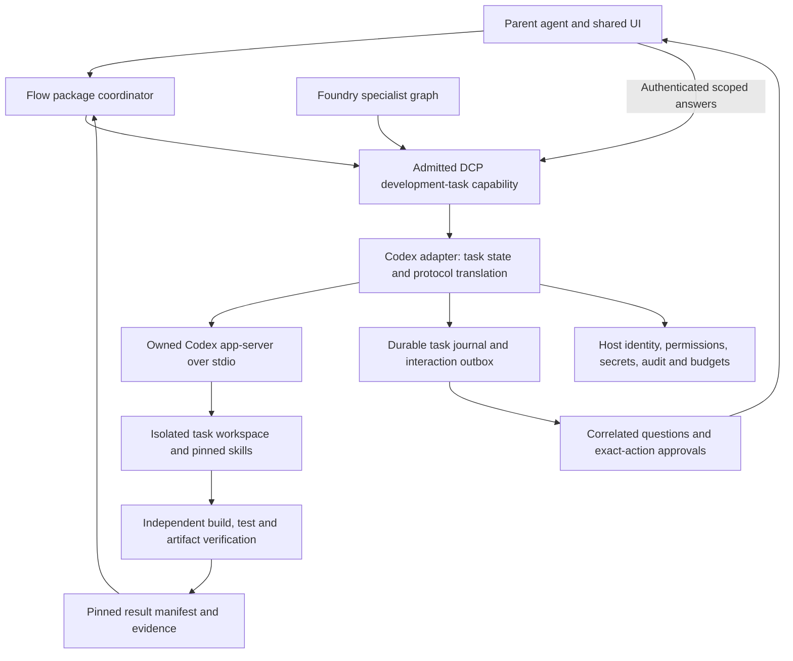
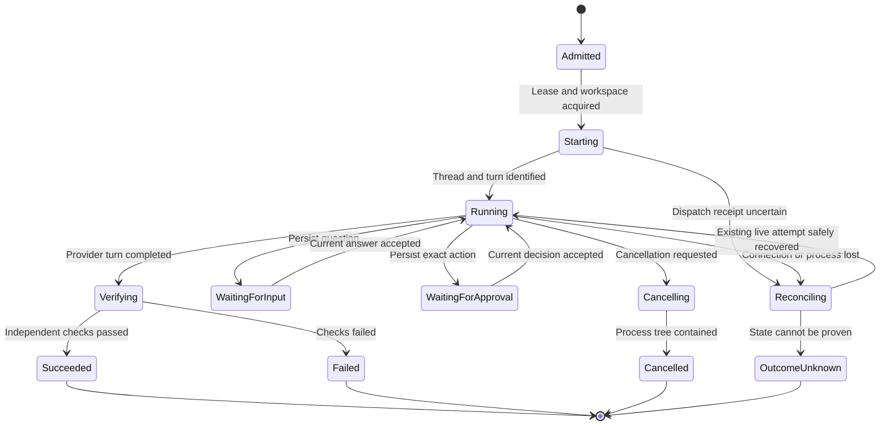

# Design: Foundry/Flow to Codex app-server development-task adapter

Date: 22 October 2026; implementation tracking updated 23 October 2026. Status: host-bound adapter
and Flow wait integration implemented locally; production activation and real-provider coding
acceptance require configured host bindings and separate evidence. This is the outbound A06
development-runner design, not the inbound Foundry app-server-compatible gateway.

Implementation: [adapter HLD](../../unfurl-adapter-codex/docs/HLD-codex-adapter.md),
[adapter LLD](../../unfurl-adapter-codex/docs/LLD-codex-adapter.md),
[build spec](../../unfurl-adapter-codex/docs/REPO-codex-adapter-build-spec.md),
[integration](../../unfurl-adapter-codex/README.md) and
[validation evidence](../../unfurl-adapter-codex/docs/EVIDENCE-codex-adapter.md).

Governing suite documents: [HLD](HLD-dcp-software-assembly-skills.md),
[LLD](LLD-dcp-software-assembly-skills.md) and
[API/hooks/runtime plan](PLAN-skill-api-hooks-runtime-graphs.md).

## 1. Decision and ownership

Implement a DCP-visible development-task provider that drives a host-owned Codex app-server
process. Reuse the existing adapter/protocol skills and return verified artifacts, rather than
build a new coding engine or copy the parent conversation into the child. Flow owns deterministic
package orchestration; Foundry owns its agent graph, specialist decisions and caller governance;
Codex owns execution inside its delegated task. The adapter translates lifecycle and controls
between them. Fabric owns capability discovery, composition, compilation and verification.

Implementation home: a separate local `unfurl-adapter-codex` repository, following the existing
component-adapter separation. Its provider artifact implements neutral `ContractInvocable`
interfaces and supplies DCP claims/catalog/operation schemas. Product-specific Flow/Foundry
projections belong in optional integration artifacts, not the adapter core. This repository
has its own HLD, LLD and build spec. No remote repository or production deployment is implied.
Product-owned changes and remaining host prerequisites are listed in section 11.

Do not add Codex wire types, process management or model SDKs to DCP core or the neutral substrate.
Foundry does not acquire a dependency on `unfurl-client-gateway`. Its existing ACP implementation
serves incoming clients; Zed is an optional user interface, not the task executor. Existing gateway
conversation stores must not be reused as if Codex-owned threads were Foundry execution records.

The authoring pipeline may use Flow/Foundry even when the generated application selects neither.
No deployment, push, merge, live broker order or production mutation is implied by a coding task.

## 2. Target architecture

The diagram is a target binding view, not executable Flow syntax. The adapter owns one task
aggregate; the package coordinator owns the enclosing run. Only references and concise progress
cross the parent boundary. Full child history remains access-controlled and separately retained.

## 3. DCP capability contract

The following operation names and records are provider schemas implemented in adapter version
0.1.0, not pre-existing product APIs or new DCP core fields. Author the provider claim, catalog, faults and operation schemas
using `add-dcp-capability`; compose/sign/accept through existing Fabric/DCP mechanisms. Registry
entries remain discovery-only and must not certify runtime readiness.

| Proposed operation | Input | Result and effect |
| --- | --- | --- |
| `development.task.submit` | Stable request key, requirement artifact refs, workspace allocation ref, pinned skill selection and expected input revision | Durable task receipt; starts bounded workspace-writing work asynchronously |
| `development.task.status` | Task reference and optional event cursor | Authorized snapshot, bounded redacted events and pending interactions; read only |
| `development.task.answer` | Task/interaction reference, expected revision, typed answer or approval decision | Idempotent decision receipt; may release exactly the referenced action |
| `development.task.cancel` | Task reference and expected revision | Durable cancellation receipt; completion follows confirmed worker containment |
| `development.task.reconcile` | Task reference and expected revision | Inspect provider/workspace state and record recovery disposition; no automatic new turn or replay |
| `development.task.result` | Task reference | Immutable result/evidence/artifact references when available; read only |

Resume a live question using `answer`; reconcile after connection/process loss. A new coding turn
after reconciliation requires an explicit authorized submit referencing the prior task and new
input revision. Do not expose an unrestricted remote command, arbitrary skill path or caller-selected
Codex endpoint. The host resolves logical references and selects an allowlisted provider profile.

Task inputs include exact repository baseline, sanitized API evidence, requested operations,
acceptance checks and constraints. In the Kotak case, broker wrappers and strategy capabilities
remain separate implementation tasks. No full portfolio history is needed merely to author wrappers.

The adapter emits provider claim/catalog JSON, operation input/output schemas, runtime binding
requirements and requested host-tool projections. The assembly owner selects consumers, accepts
contracts and supplies bindings. Neither provider claims nor model output grants access.

### Trusted context and mandatory ports

Tenant, principal, accepted contract, grants, target account scope where applicable, trace and
binding identity come from trusted execution context. Task IDs are opaque, not bearer authority.
Every read and control operation reauthorizes ownership and current policy, including after revocation.

| Port concern | Binding responsibility |
| --- | --- |
| Identity/authorization/policy | Host establishes principal, allowed task scope, tool permissions and revocation |
| Workspace/process isolation | Host allocates isolated roots and contains filesystem, processes and network |
| Secrets/provider authentication | Host resolves Codex authentication and private dependency access via SecretRefs |
| Durable task store/artifact store | Host supplies transactions, leases, event/outbox retention and immutable artifacts |
| Interaction/approval | Host authenticates answers and records exact-intent decisions; parent UI presents them |
| Audit/telemetry | Host receives attributable metadata and redacted progress; protected content has separate access |
| Budget/quota | Host bounds concurrent tasks, runtime, calls, storage and available usage/cost limits |

Missing required bindings reject task admission. Logical port descriptions are not claims that
all corresponding product interfaces already exist. Reuse inspected ports first; add missing
contracts under the appropriate owner before implementing concrete services.

## 4. Codex compatibility profile and transport

Use a dedicated stdio process per active task for the first implementation: absolute allowlisted
executable, separate argv, task-specific working directory, controlled environment and protected
task-specific Codex state/configuration. Never attach to a user's open IDE thread or inherit the
parent's unrestricted Codex configuration, plugins, MCP servers or shell credentials.

Pin executable version/digest, generated protocol-schema bundle digest, allowed method/request
subset, skill source/version/digest, instruction files, model selection and effective configuration.
Inspect merged repository/inherited instructions and dependencies before granting execution;
copying SKILL.md alone may omit its scripts, references and sibling skills. Resolve the complete
approved skill bundle read-only. Disallow unapproved instruction/config changes from increasing grants.

The local inspection baseline was `codex-cli 0.162.0-alpha.17.2`; this is not a production-version
recommendation or compatibility certification. Generate schemas from the selected binary with
`codex app-server generate-json-schema --out <owned-schema-directory>` and select experimental
features only through an explicit separately tested profile. Reject unrecognized required protocol
features; do not silently fall back to another execution interface.

Implement bounded newline-delimited UTF-8 JSON-RPC with strict validation, duplicate/trailing-token
rejection, separate request directions, connection epochs and finite frame/queue sizes. Continuously
drain stdout, service server requests and drain bounded/redacted stderr; do not block the reader on
a user approval. Unknown required requests fail closed with protocol-appropriate responses, not
synthetic approvals. Harmless unknown notifications may be ignored only under documented profile rules.

| Protocol surface | Adapter use |
| --- | --- |
| `initialize`, then `initialized` | Establish one connection; validate the pinned profile |
| `skills/list` | Confirm approved skill availability and compare filesystem pins |
| `thread/start` | Fresh context, workspace and host-selected permission settings |
| `turn/start` | Explicit skill item plus bounded task text; persist intent before sending |
| `item/*`, `turn/*` notifications | Correlate progress and terminal state; do not treat text as test evidence |
| Command/file-change approval requests | Translate to host decisions restricted to the pending action |
| `item/tool/requestUserInput` | Profile-gated questions; keep distinct from permissions |
| `turn/interrupt` | Request cancellation; wait for terminal/containment evidence |
| `thread/read`, `thread/resume` | Authorized reconciliation of saved provider state, not automatic execution replay |

Current documentation describes explicit skill items and lifecycle methods; concrete schemas from
the chosen binary remain the wire contract. Permission-expansion requests and MCP elicitation
are denied in the initial profile unless separately supported and tested. Do not expose
`process/spawn` or unrestricted `command/exec` through the DCP task contract.

## 5. Lifecycle, identifiers and durable dispatch

Persist task ID, stable request key, authority/pin digest, workspace/baseline, state revision,
lease owner/epoch, dispatch attempts, provider thread/turn/item references, interaction records,
event sequence, outbox receipts and result manifests. RPC IDs are connection-local and are never
task idempotency keys. Keep package-run, Flow-node, Foundry-tool-call, task, provider-turn,
approval and physical-attempt identities distinct and correlated.

Admission transactionally reserves request key plus input/authority digest. Duplicate matching
requests return the existing receipt; different inputs under that key conflict. Persist each
external dispatch intent before writing bytes. A crash between send and receipt leaves uncertain
execution; JSON-RPC does not provide exactly-once code changes. Reconcile rather than resend.

The diagram omits cross-cutting failure/cancel transitions from starting, waiting and verification
for readability. Persist those transitions too. A rejected/expired approval ends or blocks the
task according to policy; it never counts as acceptance. Task success means verified development
outputs, not a runnable end-user application or successful deployment.

Use a single-writer lease with fencing and process ownership checks. Lease expiry alone cannot
prove that the old coding process stopped. A new worker must contain or positively reconcile it
before any new workspace-writing work. OS/container supervision must prevent stale processes
from continuing under a newer lease. Bound shutdown, verify process-tree termination and retain
evidence. Detached child processes require containment beyond portable process-tree enumeration.

Process loss may destroy pending RPC interactions. Persist neutral decisions but never send them
to a different request, connection epoch or turn. If the original request cannot be restored with
verified semantics, report a recovery blocker; do not invent a replacement approval.

## 6. Questions, approvals and hooks

Before submit enforce contract/scope, pins, quotas, workspace allocation and dependency provenance.
Before each provider effect persist intent and check current authority, deadline and cancellation.
After a received outcome validate, classify, redact, journal and publish durable progress. Handle
denial, exception, cancellation and audit failure independently of normal post-hooks. A successful
RPC response or `turn/completed` does not establish correct implementation.

Persist each server interaction with connection/request/thread/turn/item identity, exact command
or file diff, working directory, requested permission scope, relevant artifact hashes and expiry.
Present it through the existing parent interaction flow. Accept one authenticated decision at the
expected revision and recheck scope before sending the provider response. Initial profile allows
one-action approval/decline/cancel only; reject session-wide approvals and policy amendments.
If the provider groups requests more broadly than the host can authorize exactly, decline them.

Human approval cannot expand the enclosing contract or workspace authority. A requested expansion
requires a separately authorized binding/task revision. Questions are data and do not grant tool
permission. Timeout/no response never means approval. If supported by the profile, set question
auto-resolution behavior so it cannot silently approve effects; otherwise interrupt/report expiry.

Unsupported live in-turn questioning must become an explicit blocked task or a completed
structured question result followed by an authorized new turn. Do not assume experimental question
requests exist in every release. Natural-language questions in output are not hidden RPC waits.

Reuse Foundry's existing tool-policy/external-call journal at the outer call boundary where it
fits. It records task submission, not every command executed inside Codex. Codex's effective
sandbox plus host isolation and mediated approvals enforce inner work. State that distinction in
audit evidence; do not claim Foundry interceptors automatically govern each internal shell call.

## 7. Workspace, secrets and artifact acceptance

Allocate a clean worktree or materialized source snapshot from an approved repository baseline;
never modify the user's active checkout by default. Canonicalize paths, reject traversal and
symlink/reparse-point escapes, enforce one writer and restrict repository/network destinations.
Use OS/container enforcement as appropriate; setting `cwd` or asking the model to stay in a
directory is not isolation. Refuse admission when effective isolation cannot meet the host policy.

Provider authentication is host-provisioned and validated before starting. Account entitlement,
model availability and authentication mode are prerequisites, not inferred from this chat login.
Avoid sharing a personal Codex home across tenants. Keep auth outside the model-readable worktree;
allow only required service credentials to the appropriate process/tool. Private dependency
credentials are not permission for unrelated external mutations. No broker trading credentials
are supplied to an adapter-authoring task.

API docs/HAR/source comments are untrusted evidence, not instructions. Sanitize captures, preserve
provenance, and scope tool access so injected text cannot grant capabilities. Pin dependency
sources and treat build scripts as executable untrusted content requiring the same containment.

Freeze outputs after worker containment. Independently inspect source changes and run approved
checks in the designated validation environment; model summaries alone are insufficient. Derive
changed files, baseline/final digests, test commands/exit codes and reports from actual execution.
Validate claims/schemas, operation coverage, lifecycle/revocation and mutation failure policies
as applicable. A06's development checks do not replace A07's coordinator acceptance and registry gate.

Return a versioned manifest containing task identity, outcome, artifact references/hashes,
adapter-result reference, test evidence, limitations and unresolved needs. Package only allowlisted
deliverables; exclude raw captures, auth/config secrets, transcripts and task journals. Failed tasks
may retain protected diagnostic artifacts but cannot publish a successful registry validation entry.

## 8. Flow and Foundry integration

Flow A06 calls the admitted `development.task.submit` and persists the task receipt before waiting.
The generic `ContractInvocableNodeExecutor` currently completes ordinary DCP outputs; its existing
special handling targets canonical agent envelopes. Do not disguise a task record as an agent
terminal envelope. Add a Flow-owned typed task-wait projection/executor, with a documented neutral
task receipt/event schema, registered through an accepted binding. This is explicit product work.

The first binding uses pull-based observation rather than a second event database: Flow's durable
wait descriptor stores task/node correlation, while the provider's durable status is the replayable
inbox. A host-scheduled, authorized poll of saved execution IDs re-reads status; completion before
wait persistence cannot be lost because a later poll observes both. Use node-specific correlation
because Flow can resume multiple nodes sharing a correlation ID. A mandatory dependent result
node re-fetches independently validated artifacts. The wait only observes a terminal task; the
result gate fails failed/cancelled tasks, and Flow validates that downstream branches cannot bypass
it. An OUTCOME_UNKNOWN task keeps the wait open until the provider's reconcile resolves it. On startup reload pinned definitions and accepted registrations before polling. Push
events/outbox redelivery can be a later independently validated binding over the same contract.

Foundry can expose the same submit/status/answer/cancel operations through a scoped tool projection.
Its tool result returns a task reference, not a hidden unbounded wait. A coordinator controls polling
or durable continuation; the agent cannot recursively invoke the package generator or start unlimited
coding tasks. Keep the canonical graph and delegated-task references inspectable. Never import
Codex thread/turn classes into Foundry's neutral graph or pretend Codex items are native Foundry runs.

The development runner's initial transport is embedded/local stdio. A remote worker is a later
independently authenticated binding with the same DCP contract; no unauthenticated WebSocket,
shared arbitrary filesystem mount or default public endpoint is implied.

## 9. Resource limits and faults

Profiles must specify finite startup/RPC/idle/task/shutdown deadlines; message/output/queue bytes;
active tasks per tenant; workspace/artifact quotas; interaction expiry and usage ceilings. Record
actual provider usage where available, with unknown cost explicitly flagged. Hard currency budgets
require a bound authoritative cost/rate mechanism; elapsed time or model estimates are not billing.

Proposed stable fault families: scope denied, pin mismatch, unsupported profile, unavailable auth,
workspace violation, quota exceeded, input conflict, stale interaction, protocol error, unavailable
worker, validation failed and outcome unknown. Keep diagnostics secret-free and distinguish
pre-dispatch rejection from ambiguous post-dispatch execution. Status reads may be retried under a
bounded policy; submit/answer never replay provider effects merely because a response was lost.

## 10. Validation and first acceptance slice

Automated protocol fixtures cover initialization, explicit skill selection, notifications,
bidirectional requests, duplicate IDs, malformed/oversized input, stalled writes, EOF and shutdown.
Use version-matched schema conformance tests; a fake provider alone cannot certify real Codex.

Host integration tests cover cross-tenant reads/answers, revocation of retained executors,
permission escalation, malicious evidence, workspace/reparse escapes, hostile names, leaked
credentials, instruction drift, subprocess containment, quotas and audit failures. Restart tests
inject crashes before/after every dispatch/receipt/checkpoint, stale leases, duplicate callbacks,
completion-before-wait, cancellation and unknown effects; assert no duplicate turn or code mutation.

Interaction tests cover allowed/denied/expired exact approvals, unsupported request kinds,
duplicate/stale answers, connection-epoch mismatch and cancelled pending controls. Verify parent
context receives compact outcomes while protected transcripts retain attributable evidence.

First real acceptance: Flow submits a bounded missing-adapter fixture with sanitized API evidence;
Codex explicitly loads the pinned adapter skill in an isolated workspace; it implements real
wrappers against a controlled provider; an approval/question round trip is exercised; independent
checks pass; pinned artifacts return; Flow resumes once and A07 accepts them. Repeat interruption
and failed-check paths. No live Kotak trading, publication or production deployment is part of this gate.

## 11. Implementation ownership and order

| Owner | Required work before acceptance |
| --- | --- |
| `unfurl-adapter-codex` | Implemented locally: HLD/LLD/build spec, DCP provider artifacts, pinned app-server client, task service, lifecycle and result manifest; bind actual host services before activation |
| Host/deployment owner | Concrete workspace/process containment, auth, durable stores, interaction ingress, secrets and budgets |
| `unfurl-flow` | Design and implement typed task-wait binding, durable event inbox and native workflow tests |
| `unfurl-foundry` | Reuse admitted tool/profile boundaries; add only demonstrated missing task interaction/projection seams |
| `unfurl-fabric` | Discover/admit/compose the new provider using existing interfaces; scoped changes only for proven gaps |
| `unfurl-dcp` authoring suite | Pin adapter/skill versions, accept typed results and replace A06 manual handoff once verified |
| `unfurl-client-gateway` | No outbound worker ownership; optional UI projections only after their own design/conformance gates |

Implement contracts and host isolation first; then a bounded real Codex task; then questions,
approval and cancellation; then durable recovery; then Flow/Foundry integration and end-to-end
acceptance. Register the adapter only with accurately reported validation evidence. The full
package coordinator remains a separate implementation milestone after this bridge is proven.

## 12. Evidence and references

Initial read-only inspection on 22 October 2026; no model task or live account call was run for this design.
Subsequent implementation checks are recorded separately in the linked adapter evidence document.
The installed CLI generated its non-experimental schema bundle under ignored local build output.
Local SHA-256 checks: `ClientRequest.json` =
`f75203a3d8fbe013035377ccb976103721abf46d4b267fb7b5b35f351ab4f399`;
`ServerRequest.json` = `f339be472737a0003efa25fba2e6e6c9237e621cd065b6d6995c51256e9dc1fb`.
These identify the inspected files only, not a complete production profile or certification.

- [Official Codex app-server documentation](https://learn.chatgpt.com/docs/app-server): protocol
  lifecycle, explicit skills, approvals, interruption and version-specific schema generation.
- [Foundry inbound gateway HLD](../../unfurl-foundry/docs/HLD-app-server-compatible-interface.md)
  and [gateway repository HLD](../../unfurl-client-gateway/docs/HLD-client-gateway.md): direction
  and authority separation; ACP conformance does not certify this outbound adapter.
- [Foundry MCP adapter LLD](../../unfurl-foundry/docs/LLD-mcp-client-adapters.md): reuse patterns
  for bounded stdio/process lifecycle and lost-outcome handling, not MCP wire semantics.
- [Flow distributed LLD](../../unfurl-flow/docs/LLD-flow-distributed-engine-java.md): accepted DCP
  dispatch, durable waits, resume correlation and startup definition registration.
- Original source inspection: `ContractInvocableNodeExecutor` in Flow;
  `JournalingExternalCallBoundary` and `ExternalCallOutcomeUnknownException` in Foundry. These
  general dispatch/journaling seams alone did not supply a development-task service. The local
  adapter and explicit Flow wait/result integration now provide the implementation described above;
  deployment still requires the documented host governance bindings.
