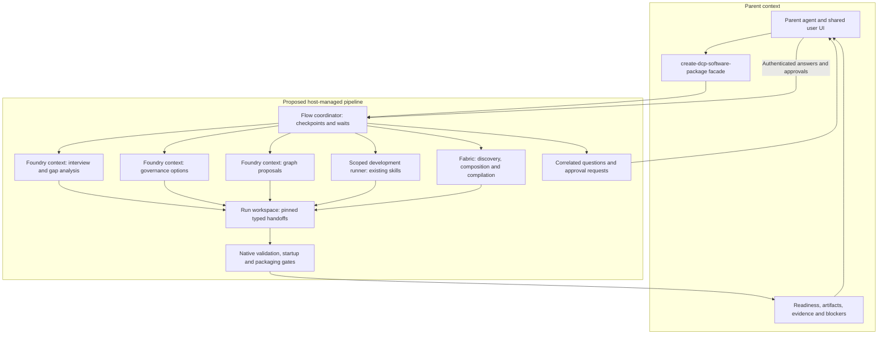

# HLD: DCP Software Assembly Skill Suite

## Purpose and ownership

The suite interviews a user, discovers or creates component adapters for a selected flow,
resolves governance, composes through Fabric, generates optional Flow/Foundry graphs and UI,
and verifies a runnable project. It is Codex authoring guidance and offline development tooling,
not a new protocol runtime, model client, compiler, signing authority or deployment service.
Development tooling includes explicit guarded API calls and an optional authenticated loopback
gateway; these remain outside the Java protocol library and do not replace product enforcement.

Canonical skills live in `.agents/skills`. `dcp-software-assembly-generator` coordinates;
`dcp-component-adapter-creator` builds business or governance adapters; `add-dcp-capability`
owns protocol authoring rules; `dcp-runtime-graph-generator` projects capability needs and accepted bindings
into native runtime definitions. The target user-facing facade is `create-dcp-software-package`,
with a proposed callable DCP operation `create_dcp_software_package`. The existing four skills
remain reusable specialist workflows. Today their calls are ordinary skill handoffs within the
current Codex task; an isolated coordinator and facade are not yet implemented. A skill file
alone cannot launch agents, enforce isolation or install a callable tool.

## Agent-as-a-Tool orchestration (target design, 22 October 2026)

The Facade and Agent-as-a-Tool patterns expose one package-building interaction while separating
specialist contexts. Flow owns durable sequencing, checkpoints, waits and cancellation; Foundry
owns bounded specialist reasoning through admitted agent definitions and pinned bindings. Fabric
remains discovery/composition/compiler authority. A host-owned, workspace-scoped development-task
port executes code-authoring work using the existing adapter and protocol skills. No new model
scheduler, compiler or product runtime is added to the neutral DCP library.

This is the target ownership/context view. Each specialist receives scoped inputs and grants;
the host enforces isolation. The workspace is data exchange, not an authority source. Existing
guarded API utilities are building blocks; the coordinator and facade above remain proposed.

Stages are interview/discovery, missing-adapter implementation, governance resolution, composition,
selected graph/UI generation, validation and packaging. Reuse existing capabilities before creating
adapters. Governance discovery begins with requirements and gates subsequent work; it is not a
late middleware overlay. The governance specialist resolves DCP ports, ownership and verified
bindings rather than injecting a fixed authentication or monitoring vendor. Dependency resolution
may revisit a stage with bounded attempts and an explicit reason; cycles remain reported gaps.

Each specialist receives only its task, pinned inputs, relevant skill instructions, scoped tool
grants and budgets. It returns a typed handoff rather than its transcript. Separate model contexts
reduce parent context growth; they are not a security boundary by themselves. Host-enforced
workspace/tool permissions provide isolation. A shared directory conveys data, never authority.
The coordinator validates results and prevents direct peer delegation or widening of grants.

Keep one user-facing conversation. Children submit structured question/approval requests; the
parent/UI presents them and routes correlated answers back. Raw child transcripts are retained
separately under access/retention policy, not copied into the parent context. Progress, decisions,
blocked prerequisites and approvals remain visible. Credentials use secure login and SecretRefs,
never interview answers. Cancellation and resume preserve pending requests and effect uncertainty.

The final response contains status, package/evidence references and unresolved needs. A ZIP is an
artifact, not proof of runnable software. `authored`, `validated`, `runnable` and `blocked` retain
their distinct evidence requirements. Authoring runtime selection (Flow/Foundry) does not force
the generated application's runtime choice: Flow-only, Foundry-only, both and neither remain valid.

## Assembly lifecycle

Authoring is incremental rather than gated on live connectivity. Draft the capability graph as
soon as the user flow is understood; refine it alongside adapter and governance work. Missing
credentials, data coverage or runtime bindings block dependent validation/execution, not all
wrapper, graph or UI authoring. Native definitions remain honest: unresolved capability needs
are recorded alongside the graph, never registered as fake accepted executors.

1. Interview for component, initial flow, exact operations, audience, environment and UI; draft
   the capability graph with unresolved dependencies immediately.
2. Query the shared adapter index, inspect pinned claims and compare exact required operations.
3. Reuse complete support or call the adapter creator with missing operations and evidence.
4. Resume from saved progress; review governance enforcement and binding separately from declarations.
5. Offer existing implementation, customer service, registered adapter or a new adapter for each gap.
6. Resolve required dependencies with a visited/active dependency graph; surface cycles and unresolved
   needs without repeatedly generating components. External host-owned dependencies remain bindings.
7. Use real Fabric discovery/matching/compile/sign/verify interfaces and caller-controlled keys.
8. Refine/validate previously drafted runtime graphs and UI, package actual artifacts, startup and shutdown instructions,
   validate and smoke test locally within authorization. Neither runtime is a supported choice.

The adapter emits claim JSON, catalog and operation schemas used to construct an assembly.
The assembly owner chooses consumers, freezes/signs contracts and supplies runtime bindings.
Claims, an index entry or successful tests do not grant invocation authority.

## Governance and project outputs

Review authentication, authorization, secrets, policy, approvals, audit, monitoring, quotas and
applicable costs. Each concern records requiredness, owner, disposition, rationale and evidence.
Bound concerns identify a real binding artifact; declared ports are not proof of enforcement.
Not-applicable is an explicit justified decision, never a silent fallback. Prefer host services
and adapters over implementing new governance products. No secret values enter suite artifacts.

A project contains progress, adapter results, optional graph result, copied/pinned artifacts,
Fabric outputs, runtime bindings, selected UI, runnable startup support and evidence. Its success
execution readiness remains blocked until missing APIs, keys, credentials or services are provided. Structural
validation, project validation and successful startup are distinct evidence levels.

## Responsibility and connection boundary

Adapters expose the live application's APIs through DCP claims, neutral wrappers and host tool
projections. Captures discover routes, payloads and result/error semantics; they are not required
to contain the customer's entire business history before wrappers can be authored. Obtain only
the evidence needed for the operation being implemented; represent unknown behavior explicitly.

Strategy components own application-specific calculations and rules. For Kotak, portfolio age,
52-week targets, net-return thresholds and proposal generation belong in a strategy component,
not in the broker adapter. Such components expose their own DCP capabilities and join assembly
resolution. Flow coordinates deterministic steps; Foundry owns agent decisions and approvals
through existing governed interfaces. Neither must implement strategy inside transport wrappers.

Host-bound connection providers own secure login/token/session lifecycle, refresh or re-login,
expiry, revocation and tenant/user/account-scoped connection resolution. Adapters may implement
provider-specific login/token endpoint wrappers and a connection-provider adapter, but neutral
API wrappers consume trusted scoped context through a port, not Flow/Foundry product dependencies.

Use OAuth 2.0 when the provider supports it; OIDC identifies application users and does not
automatically authorize downstream accounts. A provider's custom client-token/session APIs can
be wrapped without relabelling them OAuth. Developer application credentials are adapter config
SecretRefs; client login inputs pass through a secure login surface into host-held references,
never model arguments. Raw credentials and access/refresh/session tokens remain in the host
secret/session store. Trusted service context preserves principal, tenant, provider account,
binding, grants, expiry and correlation. Application credentials alone confer no user authority.

Author connection lifecycle and failure requirements before choosing a concrete provider.
Reject mismatched accounts/audiences, expired or revoked contexts, cross-tenant refresh and
unbound grants. Token renewal must not replay an ambiguous mutation. The skills specify and
bind existing ports; missing product implementations remain explicit owner-scoped gaps.

## Discovery and persistence

`adapters/adapter-registry.json` is a shared versioned discovery index classified by domains,
not a competing Fabric catalog. Entries pin source claim/catalog/evidence bytes with SHA-256.
Selection rechecks actual artifacts and claim offers before importing into Fabric. Projects
record the exact selected adapter versions and locally packaged artifact digests.

File-based handoffs are versioned authoring records, not additional DCP wire constructs.
Resume verifies identities and artifact digests, preserves known answers, and invalidates
derived results after drift. Raw captures and credential values remain outside these records.

## Boundaries

Native Flow/Foundry validators remain authoritative. Flow owns deterministic orchestration;
Foundry owns agent decisions and canonical inspectable agent graphs. Combined graphs use
the current governed `agent.run`/pinned `agentRef` interface where supported; no inline
reasoning scheduler or direct vendor-call bypass is generated. UI is asked per project.
Missing product APIs are explicit blockers, not an instruction to modify products in this suite.

See [LLD](LLD-dcp-software-assembly-skills.md) for formats, tooling and verification.

The proposed [API, hook and runtime graph implementation plan](PLAN-skill-api-hooks-runtime-graphs.md)
maps actual Fabric/Flow/Foundry calls, existing interceptor configuration, missing host bindings,
authoring/application graph nodes and acceptance scenarios. Its proposed hooks and graphs are not
claims of already installed or validated runtime implementations.
