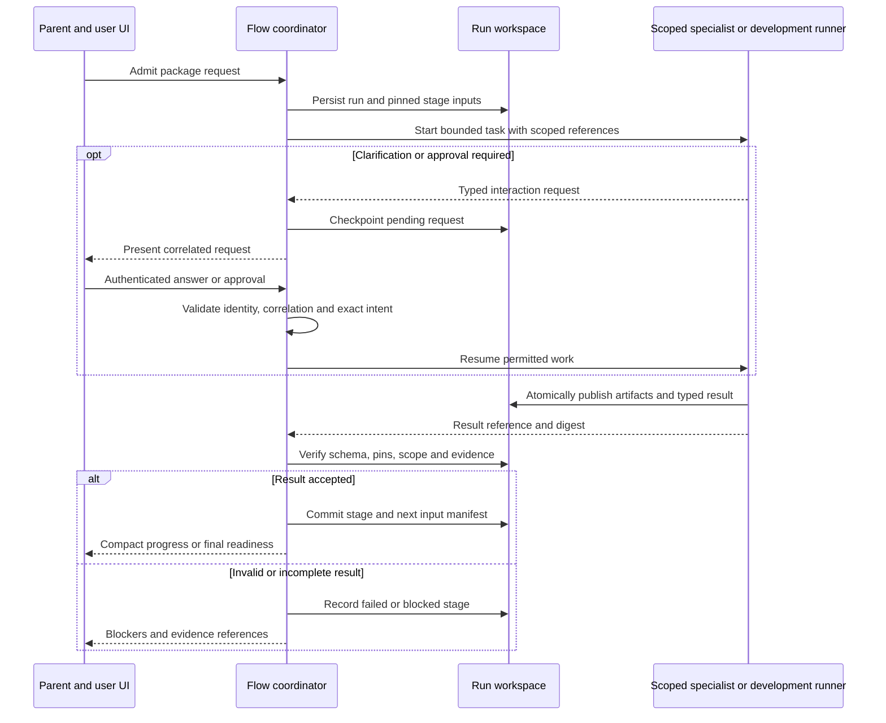
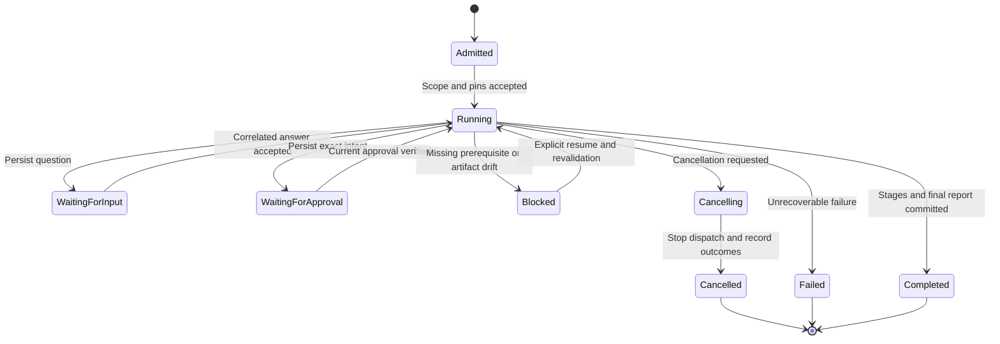

# LLD: DCP Software Assembly Skill Suite

## Layout and dependencies

Coordinator implementation revision, 24 October 2026: add the fifth canonical skill
`create-dcp-software-package`, coordinator run/interaction/result schemas and explicit installer
support. Executable sequencing lives in Flow's host-bound package coordinator; canonical suite
payloads remain version 1. The new schemas are separate authoring envelopes, not DCP core fields.
See [Flow coordinator LLD](../../unfurl-flow/docs/LLD-software-package-coordinator.md) for concrete
operations, single-writer recovery, stage context/verification ports and packaging behavior.

Five sibling skill folders live in `.agents/skills`. Shared handoff schemas and CLI live in
`dcp-software-assembly-generator/assets` and `scripts/suite.py`. Sibling relative references
work in the repository and after installation. The registry and its schema live in `adapters/`.
Python 3.11+, PyYAML and jsonschema are development-only dependencies in `requirements.txt`
beside the CLI. They are not Maven or Java protocol dependencies.

## File contracts (version 1)

Additive revision, 19 October 2026: existing version-1 records remain valid. Progress may use
`undecided` for UI/runtime during interview rather than inventing choices. Handoffs may include
`connections` and progress may include `strategyComponents`. Graph results may include
`unresolvedNeeds` and empty bindings during authoring. New `authored` status requires passing
structural evidence and actual graph artifacts but permits explicitly unresolved dependencies;
it never authorizes activation. If native syntax validation itself is blocked, retain draft status.
`validated` and `runnable` keep their stricter completion gates and require resolved bindings.

Connection requirements record identity, provider, host lifecycle owner, authorization model,
`oauth2` or `provider-token` protocol, credential SecretRefs labelled developer/client, binding
artifact references, evidence and declared/configured/verified status. OIDC application identity
is recorded through normal authentication governance, separately from downstream authorization.
Connection records contain neither live credentials nor token values and are authoring descriptors,
not replacements for DCP runtime bindings or an implemented connection manager.

Strategy components reuse versioned capability/artifact selections with explicit `role: strategy`.
Their claims participate in required-operation coverage and pin verification alongside adapters.
No new DCP wire model or Java runtime implementation is introduced by these authoring records.

All files use UTF-8 JSON with `schemaVersion: 1`, reject unknown fields and require typed
identities. Schemas are authoritative for concrete fields. Artifacts use project-relative
`path`, lowercase SHA-256 `sha256`, and a descriptive `kind`; paths cannot escape their root.

- Registry: monotonic `revision`, adapters keyed uniquely by `(id, version)`, multiple domains,
  source repository/path, pinned claim/catalog/evidence, exact capability name/version/effect.
  Source paths resolve relative to the registry directory. Missing checkouts block verification,
  not JSON discovery. Summaries and evidence levels cannot certify provider access.
- Progress: project identity, component/flow, required operations, requirements/decisions,
  stage, status, completed stages, selected versioned adapters and packaged artifacts,
  dependency edges, unresolved needs, governance decisions, UI/runtime selection and checks.
- Adapter result: project/request identity, adapter identity/version, capabilities, artifacts,
  governance decisions, checks, limitations and status. It returns to the assembly skill.
- Graph result: project identity, selected runtimes, native definitions, binding artifacts,
  checks, limitations and status. Neither runtime requires no graph result.

Evidence records identify level, command/description, outcome and a pinned report artifact.
Commands are text only: the CLI never executes them. No secret values or unstructured
captures belong in decisions or reports. Schema checks do not implement DLP; operators and
skills must sanitize evidence before including it.

## CLI contracts

Run `python <skill>/scripts/suite.py --help` for exact arguments.

- `validate KIND FILE [--artifacts]`: schema and semantic checks; optional file/digest verification.
- `query REGISTRY [--domain DOMAIN] [--capability NAME ...] [--verify]`: per-adapter covered and
  missing operation names. Query results are candidates; version constraints still require Fabric.
- `pin ROOT PATH KIND`: prints an artifact reference without copying or executing it.
- `handoff PROGRESS [--adapter-result FILE] [--graph-result FILE]`: read-only identity,
  requested-operation and runtime consistency checks before the coordinator merges child outputs.
- `upsert REGISTRY ENTRY`: verifies an entry, replaces only the same identity/version or appends,
  increments revision, validates the resulting registry and atomically writes it. No live calls.
- `install --destination DIR [--replace-local]`: synchronizes only the five suite skills.
  Default refuses divergent destination files. Explicit replacement overwrites suite-owned files;
  unrelated files are preserved. A per-skill source marker locates the canonical checkout/index
  and tracks managed file hashes so later sync removes only stale managed files.

Shared semantic validation rejects duplicate identities, dependency cycles, absent operation
coverage at completion, inconsistent runtime/UI selection, required unbound governance and
completed states with unresolved needs or failed checks. `validated` requires passing local
and protocol checks; `runnable` additionally requires passing startup evidence. Write capability
results require nonempty approval and unknown-outcome policies. Governance completeness is
checked at assembly completion, not incorrectly imposed on standalone adapter owners.
For graph results, only completed validation requires nonempty runtime bindings and resolved needs;
authored/draft graphs can expose missing bindings. Completed assembly/graph connections must be
verified, with real binding and evidence references. Adapter results may return declared host needs.

Registry verification compares identity, version, exact offers and effect against the actual
claim and its embedded catalog claim, verifies digests and checks referenced operation schema
files. It does not replace Java ClaimValidator or Fabric admission. Project resume verifies all
recorded artifact digests; no automatic replacement or re-signing after drift.

## Authoring API execution implementation

`scripts/api_calls.py` is a development-time Ports & Adapters runner, outside the Java library.
It loads a closed, versioned service/tool manifest and a host profile pinned by an explicit
SHA-256 supplied by the caller. Profiles bind tenant/principal, operation grants, service origins,
optional authentication SecretRefs (`secret://env/NAME`) and resource limits. It does not resolve
model-supplied URLs or accept inline credentials. HTTPS is mandatory except explicit loopback HTTP.
Secrets are resolved by the transport adapter only and never copied into graph or journal output.

Fixed mandatory pre-hooks enforce scope, schema and absence of secret-bearing input; the SQLite
journal durably records intent before transport. Post-hooks classify HTTP/tool/business status,
validate output, recursively redact and record outcome. Hooks are named/validated implementations,
not shell snippets. Call ids pin operation/arguments/profile/principal. Reuse never dispatches
again; an interrupted DISPATCHING attempt is OUTCOME_UNKNOWN. No transport retries or redirects.
Unknown mutation outcomes are reported, never interpreted as safe failures. Call journal and audit
metadata commit locally together; remote effects are not atomic with local persistence.

The optional loopback-only `/preflight/{operation}` and `/calls/{operation}` gateway makes the
same runner available to native Flow `connector.request` nodes. The concrete host-bound
`AuthoringConnectorTransport` in `tools/skill-runtime-validation` resolves bearer SecretRefs;
plain `http.request` cannot resolve them and is not used for credential-bearing gateway calls.
The gateway requires a separate bearer secret from its host profile and bounds
request bytes/concurrency. It is local development tooling, not a production identity service.
Existing host/adapter authorization remains mandatory regardless of these authoring checks.

`scripts/runtime_bundle.py` emits native Flow call/gate subgraphs, native Foundry agent/skill
definitions, prompt resources, hook policy and an explicit capability/connection needs inventory.
It never registers them. The bundle uses the gateway so Flow calls cannot accidentally bypass
runner hooks. Native Java validators, actual tools and profile binding checks establish the
validation level. Missing model/login/development runner/GTT capabilities remain gaps; no fake
implementation or credentials are supplied. Supplied schemas describe authoring configuration,
not new DCP core protocol fields. Broker mutations are not in the authoring-call allowlist.

Optional `callPlan` handoff metadata pins a call-manifest artifact and exact operation ids.
`suite.py validate call-manifest/call-profile` performs structural validation, while handoff
`--artifacts` also verifies hashes and operation lookup. Real invocation additionally enforces
the pinned host profile and manifest digest. Native validation runs as a separate development
Maven module, with product dependencies kept outside the DCP production POM.
Because that module is standalone, it declares the same configurable Lab GitHub Packages
repository as the root build, including snapshot resolution and server id `github`. CI supplies
credentials through Maven settings; dependency availability is required and must not be skipped.

## Installation and validation

Install explicitly from the canonical CLI into `$CODEX_HOME/skills` (or `~/.codex/skills`).
The canonical checkout must remain available for registry updates; otherwise the skill reports
the missing source instead of silently using a different registry. Skills remain discoverable.

Run `python -m unittest discover -s <skill>/scripts/tests -v` for isolated fixture tests and
`python <skill>/scripts/check_suite.py` for metadata/reference/registry structural validation.
CI runs these without sibling repositories; `validate registry ... --artifacts` additionally
checks the inspected Kotak checkout when locally available. Fixture tests do not establish
autonomous interview quality, product graph validity or live API certification; validate those
through real projects and native tools before making those claims.

## Isolated package coordinator (host-bound contract, 24 October 2026)

The host-bound Flow implementation and fifth facade skill implement the coordination boundary.
Existing version-1 specialist handoffs remain unchanged; separate package-run, package-interaction,
package-result and package-manifest schemas describe parent-facing records. No public HTTP endpoint
or automatic deployment/profile activation is implied. Canonical handoff verification also has a
read-only `scripts/package_handoff.py` adapter; independent native/build/startup checks remain required.

### Admission and execution ports

See [Codex development-task adapter design](DESIGN-codex-development-task-adapter.md) for the
implemented local outbound provider contract, version-pinned wire mapping, workspace/process lifecycle,
durable controls and explicit Flow task-wait integration. Activation still requires the documented
host authorization, sandbox, credentials and verification bindings. No generic DCP response is assumed
to suspend a Flow node automatically.

Expose skill `create-dcp-software-package` and operation `create_dcp_software_package`
through a provider-owned DCP claim, operation schemas, accepted contract and runtime binding.
The operation accepts package name, permitted target-directory reference and optional saved-run
reference. Trusted tenant/principal, workspace roots, budgets and grants come from the host,
never those arguments. Long-running execution returns a run reference and current state, with
host-bound status, question-answer, cancellation and resume capabilities. This is asynchronous
admission with UI progress, not a synchronous call that hides user questions indefinitely.

Model orchestration, development-task execution, workspace access, interaction, artifact storage,
audit and secrets as DCP ports before implementing concrete bindings. Flow hosts the coordinator;
Foundry invokes pinned specialist agents using existing governed execution seams; Fabric performs
real composition. A Foundry agent definition cannot execute a Codex SKILL.md as code. The explicit
development runner supplies that bridge with scoped filesystem/process/network access. The local
`unfurl-adapter-codex` implementation supplies this execution boundary; the package coordinator and
its deployment-specific stage bindings remain host-owned. Without those bindings, a local Codex handoff remains a manual
wait and must not be reported as autonomous pipeline completion.

### Workspace and handoff protocol

The stage handoff keeps code and evidence in the workspace while returning only pinned
references to the coordinator. The same checks apply to adapter, governance and graph stages.

Create a run-owned root beneath a host-approved directory. Use logical subdirectories for input
evidence, adapter outputs, governance bindings, assembly, graphs, UI, reports and package staging.
Assign one writer per stage; publish outputs atomically, then pin their bytes before downstream
use. Existing progress, adapter-result and graph-result records remain canonical payloads.
An additional coordinator envelope records run/stage/attempt identity, schema version, input and
output hashes, selected agent/skill/profile versions, authority snapshot reference, evidence and
state revision. No secrets or transcripts belong in these handoffs. Keep audit and transcripts
in separately controlled storage with references and retention policy.

Resolve and verify paths before every read/write/package operation, including symlink/reparse-point
escapes. Reject traversal, unapproved absolute roots, duplicate archive paths and output overwrite
without explicit authorization. Treat names as data; never interpolate them into shell commands.
Exclude raw captures, credentials, journals and transcripts from distributable archives by default;
package only declared artifacts. Pin the final manifest and archive digest after validation.
The private names (path segments, segment prefixes, file names, suffixes and artifact kinds) are
defined once in `assets/package-private-paths.json`. Flow's packager ships a byte-identical copy
(`dcp/software-package/private-paths.json`) and the suite's package-manifest check loads the same
file. The registry pins Flow's copy as a `package-path-policy` artifact; registry validation
rejects a pin whose digest differs from the canonical asset and requires the package coordinator
entry to pin exactly one, so the Java and Python rules cannot drift.

### State, interactions and recovery

Proposed run lifecycle below is separate from package readiness. Cancellation/failure may occur
from any active or waiting state; those cross-cutting transitions are summarized from Running
to keep the diagram readable. A terminal run is not automatically a runnable package.

Run states distinguish admitted, running, waiting-for-input, waiting-for-approval, blocked,
cancelling, cancelled, failed and completed. Execution completion is separate from package readiness
(`draft`, `authored`, `validated`, `runnable`, `blocked`). Persist transitions with compare-and-set
revision checks, stage attempts, bounded deadlines and child-run identifiers. Acquire a run lease
or equivalent single-writer mechanism. Resume verifies all pins and authority before continuation;
drift invalidates dependent outputs and requires explicit revalidation, never silent replacement.

Question requests contain run/stage/request identity, purpose, question/options and affected
decision references. Answers are authenticated, correlated and accepted once for the active request;
duplicates are idempotent and stale/cross-run answers rejected. The parent receives compact progress
and pending requests, not full child histories. Approval requests additionally pin exact effect,
arguments, target account, expiry and policy context. A conversational answer cannot manufacture
approval authority. Changed intent invalidates approval. Secure login uses a separate host surface.

Cancellation stops new dispatch, requests child cancellation and records in-flight outcomes.
An interrupted external effect remains unknown until reconciled. Use the existing durable call
journal/no-replay semantics; do not restart a write merely because a child failed. Bounded retries
apply only when the operation's declared policy and evidence establish safety. Child work cannot
escalate grants, spawn unrestricted peers, or consume the parent's remaining budget implicitly.

### Gates and concise results

Before each stage validate scope, pins, schemas, grants, budget and required bindings. Before any
tool effect apply existing intent/approval checks; after it classify business outcomes, validate,
redact, persist evidence and publish the handoff. Failure/cancellation paths persist independent
outcomes. Reject missing/corrupt schemas before downstream execution. Governance is checked during
requirements/discovery and again before composition, activation and effect dispatch.

The result contract carries run reference, readiness, package reference/hash when produced,
evidence reference, unresolved needs and a short summary. Unavailable prerequisites must not become
success prose. A completed authoring run may return authored artifacts with blocked readiness.
Only passing required local/protocol/startup checks and resolved required bindings establishes
runnable readiness. Live mutations and production deployment require separate authorization.

### Behavioral acceptance

Exercise a full isolated controlled-service pipeline and verify: partial adapter reuse; governance
gaps; malformed or changed child outputs; context separation; child tool/workspace restrictions;
question routing and duplicate/stale answers; approval scope and expiry; restart at every stage;
lease contention; cancellation during a call; no replay after unknown outcomes; secret-free archives;
path traversal, reparse-point escapes and hostile package names; prompt injection in API evidence;
budget exhaustion and unavailable development runner. Verify compact parent results retain blockers
and evidence without transcripts. Repeat runtime/UI choice cases, including neither-runtime projects.
Mocks alone do not establish real agent isolation, host enforcement or end-to-end runnable software.
