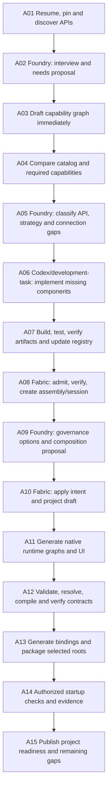
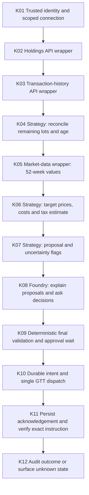
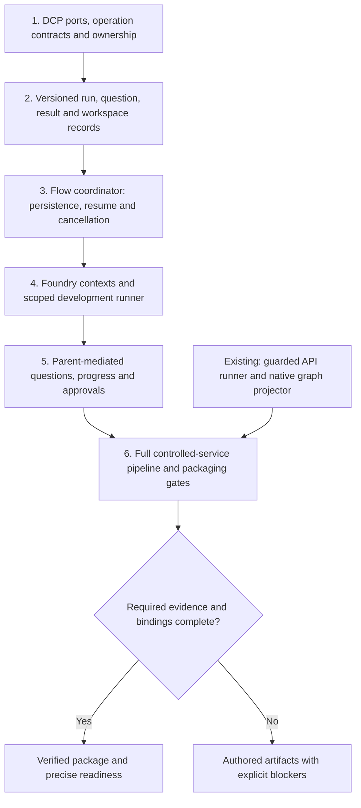

# Plan: API-driven skills, tool hooks and runtime graphs

Date: 19 October 2026; coordinator design revised 22 October 2026. Status: authoring infrastructure
partly implemented as recorded below; isolated package coordinator remains proposed. Configuration
excerpts are not installed runtime bindings. Extends the suite HLD/LLD and responsibility review.

## Implementation record — 19 October 2026

Delivered: source-grounded 26-operation call manifest, closed pinned host profiles, mandatory
pre/post/failure hooks, durable no-replay journal, bounded HTTP transport, authenticated local
gateway, native connector adapter, 26 preflight/call/post Flow subgraphs, two native draft Kotak
graphs, four Foundry advisory agent/skill bundles, policy fragments and native validation tests.
Skills reference the actual utilities rather than merely describing future API calls.

The graph projector and all generated nodes are real native definitions, but application providers
and their admitted bindings are not fabricated. Broker transaction/market/GTT-write implementations,
the strategy and tax/charge services, live login and runtime/UI selection remain explicit project
needs. The initial local-Codex code handoff is used; no unattended development service is claimed.
This is authoring infrastructure plus initial graphs, not a completed live Kotak application.

See the [API execution guide](../.agents/skills/dcp-software-assembly-generator/references/api-execution.md)
for actual commands and the suite evidence document for validation scope.

## 1. Execution model and scope

Produce two separate graph families:

1. **Authoring graphs:** interview, inspect APIs, implement wrappers/strategy, admit artifacts,
   compose and package software. Fabric remains the composition authority, Flow owns durable
   deterministic steps, Foundry supplies bounded reasoning and structured proposals.
2. **Application graphs:** the generated application's actual business flow, such as Kotak
   portfolio -> eligibility -> proposals -> approval -> GTT -> reconciliation.

The existing integration is concrete: Flow runbooks call Fabric tools, and Fabric delegates
authoring to Foundry through `DcpAuthoringClient` when configured. This is not a claim that
every Fabric method is already executed by a Flow engine. Reuse those seams rather than adding
Flow/Foundry implementation dependencies to the DCP library or vendor core.

Codex skills are the development-time driver. Foundry runtime skills are separate, versioned
`SkillDefinition` bundles. A server cannot execute a Codex SKILL.md or edit a repository merely
because its name appears in a graph. Initial code-generation nodes hand off to the local Codex
adapter/strategy workflow and return tested artifacts. Unattended authoring requires an explicit
host-owned development-task port/runner with scoped workspace permissions; that is a new binding,
not an existing Fabric endpoint. The Flow parent waits for the correlated result when necessary.

The [Foundry/Flow to Codex app-server adapter](DESIGN-codex-development-task-adapter.md)
now has a local host-bound implementation: a separate DCP provider, pinned skills/protocol,
durable task/interaction state, independent-verification boundary and Flow-owned wait/result
projection. The adapter repository records exact evidence and host prerequisites. This does not
install a coding service or make the full package coordinator operational automatically.

Use logical service references resolved from runtime bindings, never hardcoded localhost ports.
Do not auto-start a deployed workflow or submit real orders while authoring the plan.

## 2. API and tool call catalog

Existing routes below are verified in source, not live availability claims. Discover health,
API documentation, tenant catalog and runtime capability/profile support before execution.
Use authenticated ingress and trusted execution context; tenant fields alone do not authorize.

| Stage | Existing call surface | Required handling |
| --- | --- | --- |
| Discover | `GET /studio/tenants/{tenantId}/catalog`, `GET /studio/tenants/{tenantId}/files`; `fabric.catalog-query`, `fabric.file-list`, `fabric.session-history` | Pin catalog/file hashes, schemas and exact versions; preserve tenant scope |
| Inventory/admit | `fabric.artifact-inventory`, `fabric.catalog-admit`, `fabric.catalog-verify` | Inspect files without loading artifact classes; validate claims; gate on required operation coverage |
| Start assembly | `fabric.assembly-create`, `fabric.needs-extract`, `fabric.session-start` | Persist assembly/session identity and exact requirements |
| Author | `fabric.authoring-converse`; direct route `POST /studio/authoring/converse` | Structured clarify/proposal/gap results; Fabric delegates to Foundry where bound |
| Apply/project | `fabric.session-intent-apply`, `fabric.dynamic-dcp-project` | Apply authorized accepted intent, then project authoritative draft graph from session state |
| Compile/resolve | `fabric.deployment-resolve`, `fabric.candidate-compile` | Validate selected shapes, dependencies and contract outputs; use current DTO fields |
| Export/bind | `fabric.export-download-all`, `fabric.runtime-binding-generate` | Verify export hashes/signatures; respect signed root versus compiled-support envelope requirements |
| Assemble runtime | `fabric.flow-root-assemble`, `fabric.foundry-root-assemble` | Package selected runtime roots; these are not substitutes for native graph validation |
| Flow authoring | `POST /tools/{toolName}` for `flow.workflow-draft-questions`, `flow.tool-suggest`, `flow.connector-suggest`, `flow.workflow-validate` | Inspect available schemas and executors; only current canonical models |
| Flow registration | `flow.connector-register`, `flow.workflow-register` via the same tool gateway | State mutation only within approved project scope; revalidate pins before registration |
| Flow lifecycle | `POST /start`, `/resume`, `/cancel`; `GET /workflows` | Existing typed requests; preserve workflow version, execution id, wait correlation and cancellation semantics |
| Foundry execution | `POST /dcp/agent.run`; `/dcp/composition.run` where profile advertises it | Pinned agent/composition refs and neutral ContractInvocation, with admitted contract/profile |

Fabric tool HTTP envelope is `POST /studio/tools/{toolName}` with `callId`, `toolName`,
`arguments`, `metadata`. Use the tool's real argument DTO; do not invent one universal business
payload. Tool responses include `success`, `output`, `errorCode`, `errorMessage`. HTTP 200 or
`success: true` is insufficient: runbook `output.status: GAP` is not PASS. Flow's existing
`tool.result.gate` pattern must classify this without silently skipping dependencies.

Contract signing/verification use existing Fabric capabilities/CLI and caller-authorized key
bindings. Do not invent `/studio/sign`, expose private keys as model arguments, or treat a
compile response as signed/accepted without verifying the actual output.

### Kotak calls behind the adapter

| Operation | Observed/evidenced API | Delivery state |
| --- | --- | --- |
| Holdings | `GET /api/portfolio/v2/holdings` | Existing read adapter |
| Transactions | `GET /api/portfolio/v1/transactions?instrToken=...&instrType=...` | Wrapper extension to implement |
| 52-week information | `/api/1market/52w` and captured instrument-detail route | Evidence only; establish per-instrument coverage/entitlement before freezing a wrapper |
| List GTT | `GET /report/1.1/GTT/order-book` | Existing read adapter |
| Create GTT | `POST /order/1.0/GTT/placeorder` | Wrapper extension, exact-intent approval and durable attempt journal required |
| Provider login/token | Provider-supported APIs selected after documentation/contract inspection | Connection-provider adapter; do not invent OAuth endpoints from session headers |

Hosts, routes and credentials resolve through approved bindings. Captures supply contract evidence;
they are not default credentials, full business datasets or proof of current live availability.

## 3. Authoring Flow graph and Foundry agent nodes

Logical graph below is the implementation blueprint, not executable YAML. Generate native Flow
definitions using `ACTION`, `http.request`, existing subgraphs/local functions and explicit
dependencies. New functions must be registered implementations with schemas, never empty nodes.



- A01 uses local suite resume/pin checks and actual service discovery. No model is needed.
- A02/A05/A09 use Foundry reasoning with explicit input/output schemas, model/provider binding,
  bounded context, budgets and scoped tools. Their output is a proposal, never policy authority.
- A03/A11 call the graph-generator workflow; a Foundry graph-authoring agent may propose native
  definitions, but deterministic native validators decide validity. Missing bindings stay visible.
- A06 invokes the adapter creator for vendor APIs or connection-provider wrappers; strategy
  components use the protocol authoring workflow separately. Local Codex implements/reviews;
  unattended execution needs the development-task port described above. Return artifacts, not code
  text disguised as a completed adapter. Sandbox execution and workspace/file changes stay scoped.
- A07/A08 reuse the registry CLI and Fabric tools. Independent components may build/test in bounded
  parallel branches; dependency cycles stop that branch rather than recursively generating it.
- A09 offers real governance/connection options. An unresolved choice pauses only dependent work.
- A10 consumes accepted intent, not raw model text. A11 can run from an explicit draft needs
  inventory before A10/A12 complete; the linear arrows show the resolved path, not a global lock.
- A12/A13 require real prerequisites for validation/activation. A15 may honestly return authored
  or blocked rather than claim runtime readiness. Never forge a contract, key or service binding.

**Resume/loop rules:** clarification waits persist answers; adapter-gap loops are keyed by exact
need/version and bounded by a visited set and configured task budget. Do not use automatic retries
to reapply an intent, register a graph, sign a contract or dispatch an external mutation. Query
existing state first after an ambiguous state-changing response.

**No recursion:** Fabric's authoring request can invoke its dedicated Foundry agent. That agent's
tools are narrow catalog/history/needs/intent proposal tools; it must not call
`fabric.authoring-converse` on itself. Child strategy/adapter workflows return results to the
parent; they do not start a second assembly coordinator.

## 4. Tool hooks: configuration and enforcement locations

Every real call needs an owner, request/result schema, effect class, permitted endpoint/tool,
timeout, scoped authorization, retry/reconciliation policy, and pre/post/failure behavior.
Add these references to a versioned authoring call manifest and validate that mandatory bindings
resolve. The manifest is design configuration, not a new DCP invocation protocol.

### Existing Foundry hook configuration

Reuse `ToolCallInterceptor`, `ToolPolicyChainFactory` and `ProfileAgentToolPolicyResolver`.
The runtime profile binds `kind: POLICY_CHAIN`, `adapter: default-tool-policy-chain` and a real
approval store. Agent metadata then selects the existing names below:

```yaml
metadata:
  toolPolicy:
    bindings: [audit, redact, normalizeResult, prerequisites, normalize, approval]
    prerequisiteTokens: {}
    approvalTools: [gtt.instructions.create]
    redactedResultKeys:
      - password
      - otp
      - clientSecret
      - access_token
      - refresh_token
      - accessToken
      - refreshToken
      - Authorization
      - authorization
      - Auth
      - sid
      - Sid
      - cookie
      - set-cookie
```

This is a proposed GTT agent configuration; `gtt.instructions.create` is not currently delivered.
Before-hooks run in listed order; after-hooks run in reverse. Thus arguments normalize before
approval; results normalize, then redact, then receive audit attribution. Redaction is currently
case-sensitive: explicit keys and payload-minimal audit are both required. Adapter-level
credential handling remains mandatory; a blacklist does not establish full DLP.

The default resolver recognizes only its known names. Do not add invented `connection`,
`journal` or `schema` names to the list and claim they work. Reuse existing native schema,
permission, DCP, budget and external-call boundary gates; add any missing concrete hook through
the owning host SPI and its profile factory before configuring a name. Unknown bindings fail boot.

`AuditMetadataInterceptor` attaches attribution only; durable audit storage is a distinct
host-bound dependency. Existing post-hook invariants prohibit converting failure to success or
restoring/adding result output keys. Business calculations belong in strategy nodes, not hooks.

### Hook matrix

| Call group / nodes | Pre-call requirements | Post-call requirements | Failure/unknown path |
| --- | --- | --- | --- |
| All calls | Trusted tenant/principal, contract/profile pins, schema, endpoint/tool allowlist, deadline, correlation and effect authorization | Validate result schema and logical status; redact; attributable evidence; timing/quota settlement | Sanitized failure, release reservations, checkpoint; never fabricate success |
| Catalog/file reads: A01/A04 | Tenant/file ownership and pinned snapshot | Hash/provenance and version checks; coverage remains separate from admission | Stale/missing artifact becomes scoped GAP |
| Foundry reasoning: A02/A05/A09/A11 | Minimal sanitized context, scoped tools, provider/model refs and budget | Structured output validation, grounded capability names and proposal status | Clarify/GAP or bounded correction, never unlimited agent loops |
| Developer task: A06/A07 | Workspace permissions, dependency/source provenance, bounded command set; no secret files in model context | Build/test reports, artifact hashes and architecture checks | Return exact unresolved contract/implementation gap; no stub tool registration |
| Fabric state changes: A08/A10/A12 | Authorized project scope, expected session/catalog revision and accepted intent | Read resulting state, verify identifiers/digests, persist checkpoint | On timeout query/reconcile state before repetition |
| Signing/export/binding: A12/A13 | Authorized signer/provider, pinned input contract and allowed output paths | Offline signature/content verification, root/support identity and binding consistency | Drift/signature mismatch blocks activation |
| Secure login/connection | Secure login surface, developer/client SecretRefs, provider contract and principal/account grant | Store token privately; return logical connection handle, expiry and safe evidence | Reauthentication/denial; no credential leakage or automatic order replay |
| Broker reads | Resolve verified scoped context; enforce account grant, deadline and rate limit | HTTP plus broker business status, response shape, source timestamp/completeness | Bounded read policy only; stale/unknown data blocks dependent live actions |
| GTT create | Final quantity/prices/tick validation, exact-intent approval, grant/binding recheck, durable intent and one-dispatch attempt | Persist acknowledgement/trId, safe evidence and verification/reconciliation state | Unknown outcome remains unknown; no blind retry after timeout/refresh |

**Direct HTTP/CLI and Flow paths:** Foundry interceptors do not automatically surround calls made
by Codex, a CLI, or Flow's generic `http.request`. Add a governed call-runner/decorator for those
authoring paths and explicit Flow pre/call/post nodes where needed. The real host/adapter must
still enforce mandatory authorization and effects even if an optional authoring hook is bypassed.
Inspect/reuse existing Flow permission, audit and executor boundaries before adding implementations.

Use the existing Flow `tool.result.gate` pattern after Fabric tools, including business GAP
classification. Add registered local guards for any missing checks; do not introduce unsupported
`preToolHook`/`postToolHook` node fields or arbitrary shell commands as supposed native hooks.
Approval waits use the actual durable wait/resume interface, not a model saying "approved".

**Failure hooks are mandatory design:** `after` alone is not a universal finally callback.
Before-call denial, approval wait, exceptions, cancellation and process loss need distinct
checkpoint/audit/finalization paths. Reuse Foundry external-call boundaries and Flow failure
semantics; preserve same-attempt recovery and uncertainty. Persist intent before an external
effect and retain evidence after it, even if an outcome sink fails. Do not claim atomicity with
the broker. Keep call, tool invocation, physical attempt, approval and trace IDs distinct.

## 5. Generated Kotak application graph



K02/K03/K05 use read hooks. K04/K06/K07 are deterministic versioned strategy capabilities:
model reasoning cannot override ages, quantities, thresholds or tax-input quality. K08 uses
Foundry for explanations/clarifications and may propose edits, which return to K06/K07 and
invalidate old approval. K09 waits for exact-action human approval; K10 rechecks authority and
intent identity immediately before dispatch. Missing budgets, dates, prices or tax inputs
produce explicit unavailable/uncertain proposals rather than guessed data.

Targets retain the confirmed user formulas, eligible sell quantities and sell-only 12% warning.
Proposals use final exchange-valid prices; no price/quantity normalization may silently change
the approved payload. Current market conditions, existing GTTs, reserved/available quantity and
stale proposals must be checked before submission. Approval is not standing permission to repeat.

## 6. Implementation waves and acceptance

### Single-entry Agent-as-a-Tool extension (22 October 2026)

The extension below remains proposed. Existing call-runner and native graph utilities feed its
validation gates; they do not establish that the isolated coordinator is already operational.



Add the `create-dcp-software-package` facade without duplicating the existing four specialist skills.
Its proposed `create_dcp_software_package` DCP operation admits a run into a host-bound Flow
coordinator. Foundry executes isolated bounded specialist contexts; Fabric remains the composition
authority. Code generation uses an explicit workspace-scoped development-task runner, not a claimed
ability to execute SKILL.md directly on the server. No runtime SDK enters DCP production packages.

Implement this extension in dependency order:

1. Define provider-owned DCP claims/operation schemas and host bindings for coordinator admission,
   status/resume/cancel, interaction, scoped development work and artifact access. Inspect existing
   product ports first; record missing product work under its actual owner rather than invent APIs.
2. Version the run/question/result envelopes and workspace manifest. Reuse existing progress and
   adapter/graph payloads; extend validators and explicit installer support for the facade together.
3. Implement Flow run persistence, single-writer recovery, correlated waits, attempt/deadline/budget
   limits, cancellation and pin checks. Keep run lifecycle separate from package readiness.
4. Bind Foundry specialist definitions and the development runner with least-privilege contexts.
   Coordinate interview/discovery, adapter work, governance, Fabric composition, graphs/UI and
   validation. Governance gates apply throughout; no late blind middleware injection.
5. Connect parent/UI progress and question/approval routing. Keep transcripts out of parent context;
   preserve authorized access to audit evidence. Secure credentials use host login, not chat answers.
6. Package only declared verified artifacts, with manifest/archive digests and honest readiness.
   Validate the whole controlled-service pipeline before claiming autonomous execution support.

The HLD describes ownership/context boundaries; the LLD defines proposed state, handoff, isolation
and interaction contracts. Their new coordinator acceptance scenarios supplement the existing API
and hook scenarios below. The current API runner and graph projector are building blocks, not
evidence that this new coordinator, facade or development runner already exists. Ordinary skill
handoffs remain the available execution path until the extension is implemented and validated.

### Existing API and application implementation waves

1. **Skill/API contracts:** add call manifests and references to the four skills; distinguish
   Codex driver from Foundry runtime skill definitions. Document each actual API DTO, required
   scopes, effects, prerequisite bindings and proposed owner gaps. Extend handoff validation for
   call/hook references without importing runtime SDKs into DCP core.
2. **Hook adapters:** implement the authoring call-runner/decorator where absent, bind real
   audit/connection/permission/budget ports and existing Foundry policy profile. Integrate explicit
   Flow gates and typed waits. No global credentials, allow-all defaults or unchecked direct path.
3. **Authoring graphs:** extend existing Fabric Flow runbooks, define pinned Foundry interview,
   gap-analysis and governance/graph-proposal agents and skills; implement/defer the development
   runner explicitly. Validate all definitions with native validators and admitted tool inventories.
4. **Application graph:** implement missing Kotak wrappers and separate strategy capability;
   generate the native graph and UI from the confirmed project requirements. Bind supported auth
   after contract inspection. Keep authored outputs available while live prerequisites are pending.
5. **Integration acceptance:** run complete local controlled-service authoring path, then authorized
   live read/connection checks. Real GTT dispatch requires separate exact-instruction approval.

Required scenarios: before-hook denial prevents any dispatch; wrong account/tenant/audience;
expired/revoked connections and isolated refresh; unknown hook binding; changed args invalidate
approval; reverse post-hook order and redaction; no post-hook failure-to-success conversion;
HTTP success with Fabric GAP; HTTP success with broker rejection; malformed outputs; durable
audit failure before versus after dispatch; cancellation/process restart during attempt; no
duplicate mutation after timeout/reauthentication; secret-free reports; invalid signature or drift;
direct Flow/HTTP paths cannot bypass required enforcement; authored graph with missing binding;
development runner unavailable becomes a typed wait/gap, not a fabricated adapter completion.

Acceptance is a native-validated authoring graph, correctly scoped Foundry definitions, resolvable
hook profiles, executable wrappers/strategy with controlled tests, pinned artifacts and an honest
readiness report. Local fixtures do not certify live Kotak behavior or connection compatibility.

## Source anchors checked for this plan

- Fabric `StudioToolGateway`, `StudioToolCallRequest/Result`, `DcpAuthoringClient`, Studio API LLD
  and `docs/examples/flowfoundry-runbook`.
- Foundry `ProfileAgentToolPolicyResolver`, `HumanApprovalInterceptor`,
  `AuditMetadataInterceptor`, `ResultRedactionInterceptor` and default runtime profile.
- Foundry substrate `ToolCallInterceptor`, `ToolCallInterceptorChain` and scope invariants.
- Flow `FlowServer`, authoring gateway and existing `tool.result.gate` runbook nodes.
- DCP skill suite HLD/LLD and Kotak API evidence notes. These are source inspections, not a
  claim that running services or newly proposed integrations were exercised in this planning task.
